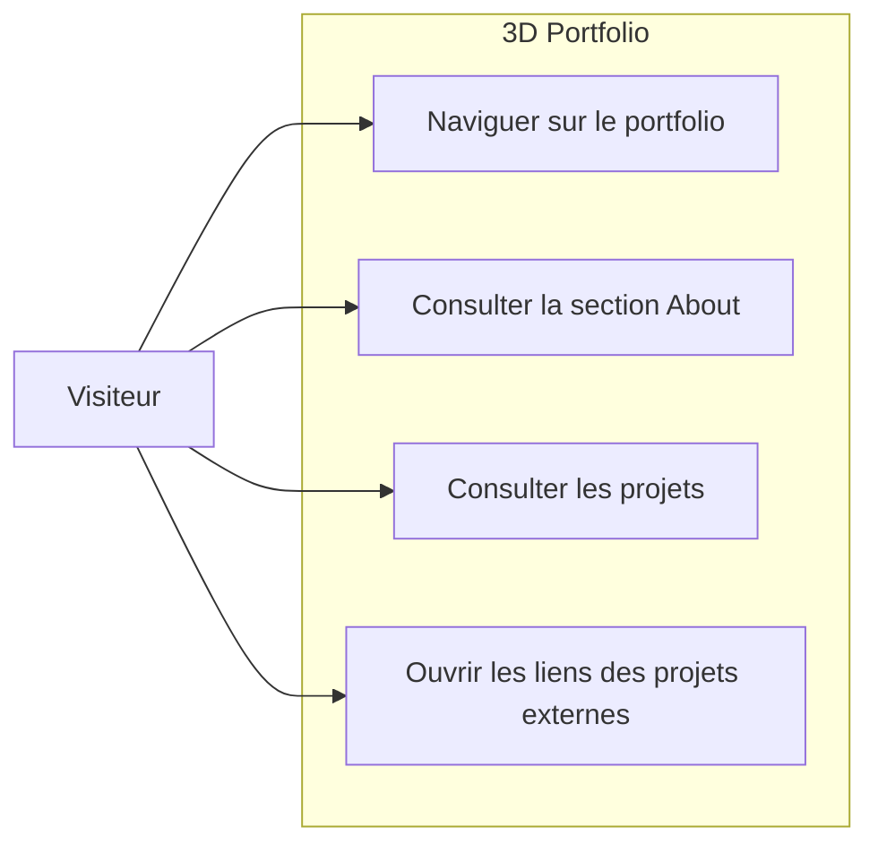

# 3D Portfolio

Portfolio 3D interactif développé avec React, TypeScript et Three.js.

Le projet met en avant des sections animées, un hero 3D immersif, une présentation des compétences et une galerie de projets.

## Aperçu

- Hero avec scène 3D (modèle Wyvern) et effet parallaxe.
- Loader d'application avec progression et fallback adaptatif.
- Section About en grille animée (cards, overlays, transitions).
- Section Projects avec aperçu visuel au survol (desktop).
- Navigation responsive (menu mobile + navigation desktop).

## Stack technique

- React 19 + TypeScript
- Vite 7
- Tailwind CSS 4
- React Three Fiber + Drei + Three.js
- Motion (animations)
- ESLint + Prettier + Husky + lint-staged

## Diagramme de cas d'utilisation



Note: un CTA « Contactez-moi » est présent dans la section About, mais il n'existe pas encore de section/formulaire de contact dédié dans l'application actuelle.

## Installation

Prérequis:

- Node.js 20+
- npm 10+

Commandes:

```bash
npm install
```

## Lancer le projet

Développement:

```bash
npm run dev
```

Build de production:

```bash
npm run build
```

Prévisualisation du build:

```bash
npm run preview
```

## Qualité de code

Lint:

```bash
npm run lint
```

Correction automatique lint:

```bash
npm run lint:fix
```

Formatage:

```bash
npm run format
```

Vérification formatage:

```bash
npm run format:check
```

Vérification qualité globale:

```bash
npm run quality
```

## Structure du projet

```text
src/
	components/
		ui/
	constants/
	sections/
	App.tsx
	main.tsx
```

## Points d'attention actuels

- Les ancres actives des sections sont: `#home`, `#about`, `#work`.
- Le lien de navigation `#content` ne correspond pas encore à une section existante.
- Le rendu 3D peut être désactivé automatiquement selon les capacités du device/réseau.
